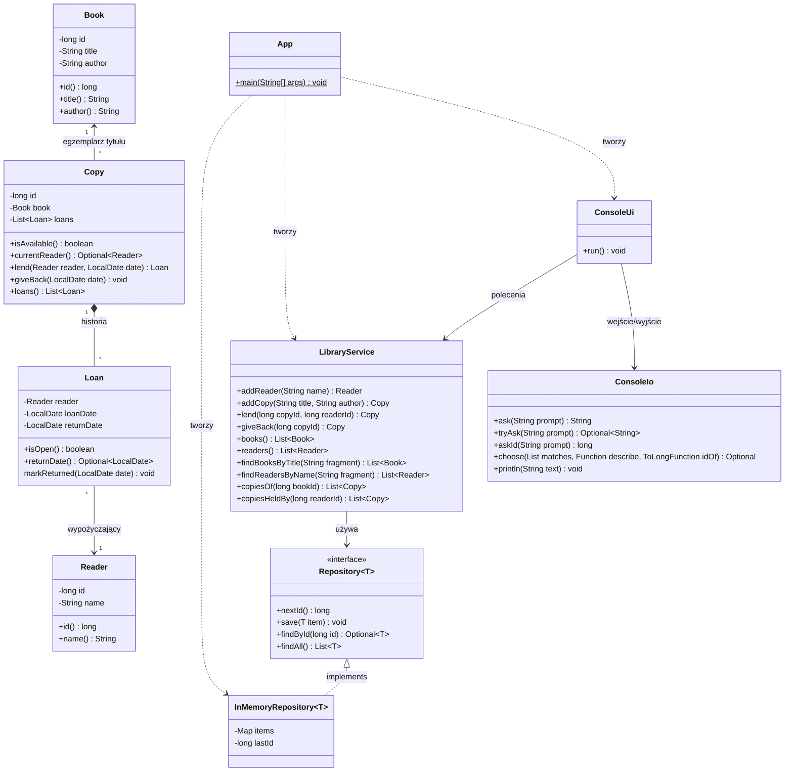

# Diagram klas

Klasy dziedzinowe: `Book`, `Copy`, `Loan`, `Reader`. Reszta to klasy techniczne (Pure Fabrication, Controller, UI).

| Zapis | Znaczenie |
|---|---|
| `A <\|.. B` | B implementuje interfejs A |
| `A *-- B` | kompozycja: B nie istnieje bez A |
| `A --> B` | asocjacja: A trzyma referencję do B |
| `A ..> B` | zależność: A tylko używa B |
