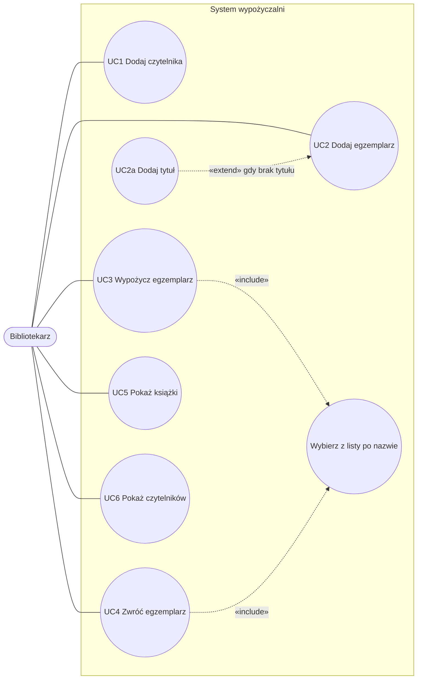

# Przypadki użycia

Aktor: **Bibliotekarz**, który obsługuje system z konsoli.

Mermaid nie ma osobnego diagramu przypadków użycia, więc użyto `flowchart`: koła to przypadki użycia, a linie przerywane to relacje «include» i «extend».

## UC1 Dodaj czytelnika

- **Warunki wstępne:** brak.
- **Scenariusz główny:**
  1. Bibliotekarz wybiera „Dodaj czytelnika”.
  2. System pyta o imię i nazwisko.
  3. Bibliotekarz je podaje.
  4. System nadaje numer, zapisuje czytelnika i pokazuje go z numerem.
- **Alternatywny 3a:** puste imię, więc system pokazuje błąd i wraca do menu.
- **Warunki końcowe:** czytelnik jest w systemie.

## UC2 Dodaj egzemplarz

- **Warunki wstępne:** brak.
- **Scenariusz główny:**
  1. Bibliotekarz wybiera „Dodaj egzemplarz”.
  2. System pyta o tytuł i autora.
  3. Bibliotekarz je podaje.
  4. System znajduje tytuł (bez rozróżniania wielkości liter).
  5. System tworzy egzemplarz z nowym numerem i go pokazuje.
- **Alternatywny 4a (UC2a):** tytułu z tym autorem nie ma, więc system najpierw dodaje tytuł, a potem przechodzi do kroku 5.
- **Alternatywny 3a:** pusty tytuł lub autor, więc system pokazuje błąd.
- **Warunki końcowe:** tytuł ma o jeden egzemplarz więcej.

## UC3 Wypożycz egzemplarz

- **Warunki wstępne:** istnieją czytelnik i egzemplarz.
- **Scenariusz główny:**
  1. Bibliotekarz wybiera „Wypożycz”.
  2. System pyta o czytelnika, a bibliotekarz podaje fragment imienia.
  3. System znajduje jednego czytelnika i go wybiera.
  4. System pyta o tytuł, a bibliotekarz podaje jego fragment.
  5. System znajduje jeden tytuł i go wybiera.
  6. System wybiera pierwszy dostępny egzemplarz i zapisuje wypożyczenie z dzisiejszą datą.
  7. System pokazuje numer wypożyczonego egzemplarza.
- **Alternatywny 3a / 5a:** kilka trafień, więc system pokazuje listę z numerami, a bibliotekarz podaje numer. Numer spoza listy kończy się błędem.
- **Alternatywny 3b / 5b:** brak trafień, więc system pokazuje „Nic nie znaleziono” i wraca do menu.
- **Alternatywny 6a:** wszystkie egzemplarze są wypożyczone, więc system to pokazuje i nie zapisuje wypożyczenia.
- **Warunki końcowe:** egzemplarz jest niedostępny, a jego historia ma nowe otwarte wypożyczenie.

## UC4 Zwróć egzemplarz

- **Warunki wstępne:** czytelnik ma wypożyczony egzemplarz.
- **Scenariusz główny:**
  1. Bibliotekarz wybiera „Zwróć”.
  2. System pyta o czytelnika, a bibliotekarz go wskazuje (jak w UC3).
  3. System pokazuje egzemplarze tego czytelnika; jeden wybiera sam, przy kilku pyta o numer.
  4. System zapisuje dzisiejszą datę oddania.
- **Alternatywny 3a:** czytelnik nic nie ma, więc system pokazuje „Nic nie znaleziono”.
- **Warunki końcowe:** egzemplarz jest dostępny, a wypożyczenie zostaje w historii z datą oddania.

## UC5 Pokaż książki

1. Bibliotekarz wybiera „Pokaż książki”.
2. System pokazuje tytuły, a pod każdym jego egzemplarze ze stanem (dostępny lub u kogo i od kiedy) oraz liczbą wypożyczeń w historii.

## UC6 Pokaż czytelników

1. Bibliotekarz wybiera „Pokaż czytelników”.
2. System pokazuje czytelników, a pod każdym egzemplarze, które ma teraz u siebie.
